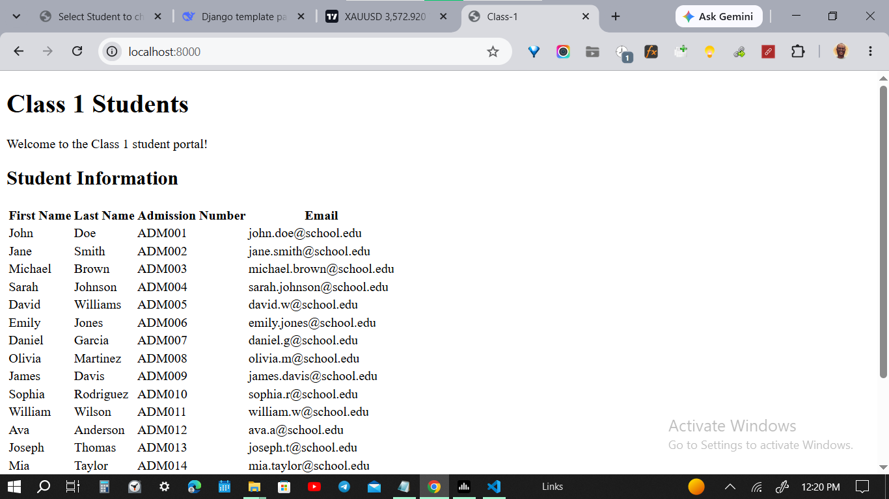
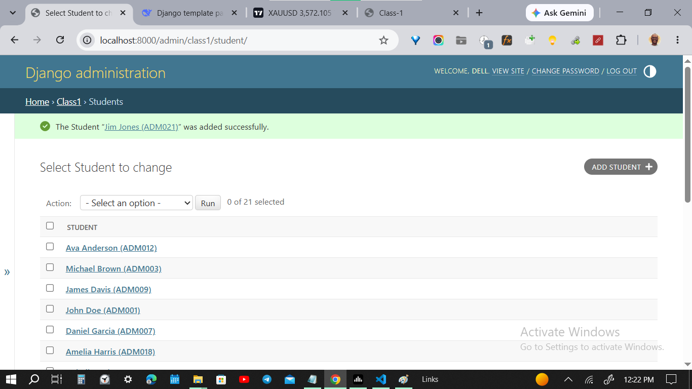

# Django School - Class Room  - Management System

A Django-based web application for managing school classrooms, students, and classes.

## 🚀 Features

- Manage students and their details.
- Organize classes (e.g., `class1`).

## Proof of Concept

Here is a screenshot of the Django `index.html` successfully auto-generating a table for the Student Object:

Here is a screenshot of the Django Admin panel successfully auto-generating an admission number:

## 🛠️ Tech Stack

- **Framework:** Django (Python)
- **Database:** SQLite3 (Development)
- **Frontend:** HTML, CSS, JavaScript (Django Templates)

## 💻 Local Setup Instructions

Follow these steps to run this project on your local machine.

### 1. Clone the repository

    git clone https://github.com/bmunyiri/Django_School_Class_Room.git
    cd Django_School_Class_Room

### 2. Create and activate a virtual environment

**On Windows (Git Bash):**
python -m venv venv
source venv/Scripts/activate
**On macOS/Linux:**
python3 -m venv venv
source venv/bin/activate

### 3. Install dependencies

    pip install -r requirements.txt

### 4. Run Migrations

    python manage.py migrate

### 5. Start the Development Server

    python manage.py runserver

Open your browser and go to `http://127.0.0.1:8000/`

## 📄 License

This project is licensed under the MIT License - see the [LICENSE](LICENSE) file for details.

## 👤 Author

**Bernard N Munyiri**

- GitHub: [@bmunyiri](https://github.com/bmunyiri)
